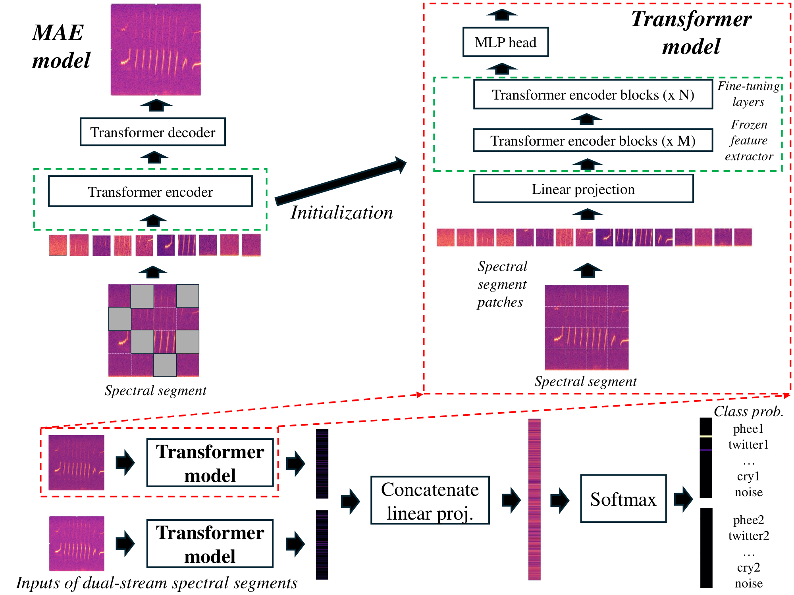

# Learning Marmoset Vocal Patterns with a Masked Autoencoder

Reference implementation for:

> **Learning marmoset vocal patterns with a masked autoencoder for robust call
> segmentation, classification, and caller identification.**
> Bin Wu, Shinnosuke Takamichi, Sakriani Sakti, Satoshi Nakamura.
> IEEE ASRU 2025, Honolulu, HI, USA.
> [IEEE Xplore](https://ieeexplore.ieee.org/document/11434811) ·
> DOI [10.1109/ASRU65441.2025.11434811](https://doi.org/10.1109/ASRU65441.2025.11434811) ·
> arXiv [2410.23279](https://arxiv.org/abs/2410.23279)

## Quick start

```bash
git clone https://github.com/caibai36/marmoset-mae && cd marmoset-mae
pip install -r requirements.txt
./run.sh           # quick CNN baseline — downloads the sample, trains, prints results
./run_mae_vit.sh   # best model (MAE-ViT; needs a GPU)
```

**Full data:** download from OSF **https://osf.io/pswqd/** (CC BY 4.0).

---

Two cooperating marmosets are recorded on separate microphones. From each
animal's audio the model jointly performs three tasks on a sliding window:

- **Segmentation** — where calls start and end,
- **Classification** — which of 8 call types (trill, twitter, phee, triphee,
  tsik, ek, chirp, chatter) versus noise, and
- **Caller identification** — which of the two animals produced the call.



*An MAE is pretrained on marmoset spectrograms (left) and its encoder initialises
a two-stream Transformer (right). Each animal's spectral segment is classified by
its own stream, and the two streams are combined to predict call type and caller.*

---

## What's included

| Model | Description | Train / Test scripts |
|-------|-------------|----------------------|
| **CNN** | Two-stream convolutional baseline (PyTorch port of the MIT model). | `local/mit_cnn_train.py`, `local/mit_cnn_test.py` |
| **MAE-ViT** | Two-stream Vision Transformer initialised from a masked autoencoder **pretrained in-domain on 48 days of marmoset spectrograms** (400 epochs, 75% masking; paper Sec. IV-C3). Best model in the paper. | `local/mit_mae_vit_train.py`, `local/mit_mae_vit_test.py` |

---

## Installation

```bash
# Python >= 3.8, a CUDA-capable GPU is recommended for training.
pip install -r requirements.txt
```
Tested with Python 3.10, `torch==2.2.2` (CUDA), `transformers==4.45.2`,
`einops`, `scipy`, `pandas`, `omegaconf`, `GPUtil`, `tabulate`.
---

## Data

### Sample (default) — runs out of the box

The script automatically download the wavefiles by default.
Three recording days / six animals: **train** Cricket + Enid, **dev**
Setta + Sailor, **test** Athos + Porthos.

To use your own copy instead: `./run.sh --mit_sample /path/to/Wave_files`.

### Full data (paper results)

Download the full corpus from OSF — **https://osf.io/pswqd/**
([DOI 10.17605/OSF.IO/PSWQD](https://doi.org/10.17605/OSF.IO/PSWQD); Landman et
al., PLOS ONE 2020, CC BY 4.0) — then point `data/<name>/info.json` at your
files and set the train/dev/test pairs in `local/mit_sample_data_prep.sh`.

---

## Pipeline stages

Both run scripts share the same five stages:

| Stage | What it does | Key script |
|------:|--------------|-----------|
| 1 | **Data prep** — slice audio into 500 ms windows (150 ms hop), build log-spectrograms and per-animal targets. | `local/mit_sample_data_prep.sh` → `local/mit_cnn_data_prep.py`, `local/mit_cnn_target_norm_single2.py`, `local/mit_cnn_wav_into_test_2500_raw.py` |
| 2 | **Train** the two-stream model. | `local/mit_cnn_train.py` / `local/mit_mae_vit_train.py` |
| 3 | **Test / predict** on the held-out pair. | `local/mit_cnn_test.py` / `local/mit_mae_vit_test.py` |
| 4 | **Cutoff** — turn frame probabilities into labelled segments at a sweep of confidence thresholds. | `local/mit_cnn_cutoff_predictor_single.py` |
| 5 | **Evaluate** — classification accuracy across cutoffs, then caller accuracy and boundary F1 at `report_cutoff`. | `local/mit_cnn_eval_acc.py`, `local/mit_cnn_eval_acc_spk.py`, `local/mit_cnn_eval_acc_boundaries.py` |

---

## Paper results (full corpus)

Call classification and caller identification on the full test pair. These are
the full-corpus numbers from the paper; the sample pipeline above runs the same
code at much smaller scale, so its numbers will differ.

| System | Call F1 | Total acc | Caller acc |
|--------|:-------:|:---------:|:----------:|
| MIT TensorFlow CNN | 0.7686 | 0.9899 | 0.7437 |
| Our CNN            | 0.7901 | 0.9907 | 0.7866 |
| Our ViT            | 0.7940 | 0.9909 | 0.7867 |
| **Our MAE-ViT**    | **0.7998** | 0.9909 | **0.8119** |

(The ViT system is described in the paper; this repository ships the CNN
baseline and the best MAE-ViT model.)

### Sample sanity check (what `run.sh` produces here)

Training the CNN on a single pair (Cricket, Enid) and evaluating on the test
pair (Athos, Porthos) of the public sample is far smaller scale than the paper
and is only meant to confirm the pipeline runs end to end.

---

## Pretrained models

The released checkpoints are the **full-corpus models that produced the paper
numbers above** (see *Full data*). You can use them directly for inference /
evaluation without any training.

| Model | File | Size |
|-------|------|-----:|
| CNN | `cnn_model.ckpt` | ~104 MB |
| MAE-ViT | `mae_vit_model_best_dev.ckpt` | ~1.4 GB |

```bash
./models/fetch_models.sh          # downloads checkpoints into exp/
```

See [`models/MODELS.md`](models/MODELS.md) for exact target paths and checksums.

---

## Citation

```bibtex
@InProceedings{Wu2025Learning,
  author    = {Wu, Bin and Takamichi, Shinnosuke and Sakti, Sakriani and Nakamura, Satoshi},
  booktitle = {ASRU},
  title     = {Learning marmoset vocal patterns with a masked autoencoder for robust call segmentation, classification, and caller identification},
  year      = {2025},
  address   = {Honolulu, HI, USA},
  month     = dec,
  publisher = {IEEE},
  doi       = {10.1109/ASRU65441.2025.11434811},
}
```

## License

Released under the [MIT License](LICENSE).
